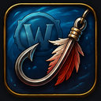

# Fishing-OneKey

> **📌 Mirror notice:** This repository is an automatic mirror.
> Primary development happens on **[git.uliana.de/DasAoD/Fishing-Onekey](https://git.uliana.de/DasAoD/Fishing-Onekey)**.
> Please open issues and pull requests there.

*[Deutsche Version](README.md)*

Cast your line and reel in the catch with **one single key**. For Midnight and WoW Forever.

No UI, no gear-management buttons, no buff tracking. Just the one hotkey. If you want a fuller "fishing helper" with lure and buff slots, this isn't that addon, and there are more feature-rich options for that.

 

## Quick start

1. Extract the folder into your AddOns directory:
   - Retail: `World of Warcraft/_retail_/Interface/AddOns/`
   - WoW Forever: `World of Warcraft/_forever_/Interface/AddOns/`

   The ready-made `.zip` is on the [Releases page](https://git.uliana.de/DasAoD/Fishing-Onekey/releases).
2. In the game options, turn on **Enable Interact Key**. Reeling in does not work without it.
3. In game, type `/fok bind` and press the key you want (ESC cancels). The key is saved and survives `/reload` and relogging.
4. Stand at the water and press your key to cast. Press it again when a fish bites to reel it in.

Tip: enable **Auto Loot** (Options → Gameplay/Interface → Loot) so your catch goes straight into your bags.

## Chat commands

| Command | What it does |
| --- | --- |
| `/fok bind` | Assign the next key you press (ESC cancels) |
| `/fok unbind` | Remove the assignment |
| `/fok` | Show the currently assigned key |

Chat messages are localized for all client languages (enUS, deDE, frFR, esES/esMX, ptBR, itIT, ruRU, koKR, zhCN, zhTW).

## How it works

- Outside of a fishing channel, your key presses an invisible secure button that casts Fishing, the same technique action bar buttons use.
- While the fishing channel is active, the key is remapped to Blizzard's own interact action (`INTERACTTARGET`), the one behind the regular interact key. When the channel ends, the remap is removed again.
- The key is set via chat command because addon keybindings through `Bindings.xml` are no longer supported by current clients.

No protected function is called from insecure code, and no third-party library is needed.

## Troubleshooting

These are Blizzard's own messages. The addon cannot check beforehand whether a cast will work.

- **"Must have a Fishing Pole equipped":** equip a fishing pole. The addon does not equip one for you.
- **"Your cast didn't land in fishable water":** face the water and move closer, then press the key again.
- **The line is cast but the catch is not reeled in:** turn on **Enable Interact Key** in the game options.

## Limitations

- No bobber detection of its own (unlike Angleur). The reel-in relies on Blizzard's line-of-sight-based "soft interact" system. If the bobber lands outside your view, the key may not respond.
- No auto-equip of pole or hat, no toys, no raft handling.

## Contributors

This project was developed together with Claude (Sonnet 5) by Anthropic and iteratively expanded.
Most of the code, architecture, and documentation was AI-generated and jointly refined.

| Role | Person / Tool |
|---|---|
| Project idea, requirements & testing | DasAoD |
| Code, architecture, documentation | Claude (Anthropic) |
