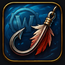

# Fishing-OneKey

> **📌 Mirror-Hinweis:** Dieses Repository ist ein automatischer Spiegel.
> Die primäre Entwicklung findet auf **[git.uliana.de/DasAoD/Fishing-Onekey](https://git.uliana.de/DasAoD/Fishing-Onekey)** statt.
> Issues und Pull Requests bitte dort öffnen.

*[English version](README.en.md)*

Angel auswerfen und Fang einholen mit **einer einzigen Taste**. Für Midnight und WoW Forever.

Kein UI, keine Buttons für Köder oder Ausrüstung, kein Buff-Tracking. Nur die eine Taste. Wer einen umfangreicheren "Fishing Helper" mit Slots für Köder und Buffs sucht, ist hier falsch, dafür gibt es featurereichere Addons.

 

## Schnellstart

1. Den Ordner ins AddOns-Verzeichnis kopieren:
   - Retail: `World of Warcraft/_retail_/Interface/AddOns/`
   - WoW Forever: `World of Warcraft/_forever_/Interface/AddOns/`

   Das fertige `.zip` gibt es auf der [Releases-Seite](https://git.uliana.de/DasAoD/Fishing-Onekey/releases).
2. Im Spiel `/fok bind` eingeben und die gewünschte Taste drücken (ESC bricht ab). Die Taste wird gespeichert und übersteht Reload und Login.
3. Ans Wasser stellen und die Taste drücken, um die Angel auszuwerfen. Beißt ein Fisch, die Taste nochmal drücken, um ihn einzuholen.

Tipp: **"Automatisches Beute nehmen"** (Optionen → Spiel/Interface → Beute) aktivieren, dann wandert der Fang direkt ins Inventar.

## Chat-Befehle

| Befehl | Wirkung |
| --- | --- |
| `/fok bind` | Nächste gedrückte Taste zuweisen (ESC bricht ab) |
| `/fok unbind` | Zuordnung entfernen |
| `/fok` | Aktuell zugewiesene Taste anzeigen |

Die Chat-Meldungen sind für alle Client-Sprachen lokalisiert (enUS, deDE, frFR, esES/esMX, ptBR, itIT, ruRU, koKR, zhCN, zhTW).

## Funktionsweise

- Außerhalb eines Angel-Channels drückt die Taste einen unsichtbaren Secure-Button, der Angeln castet, dieselbe Technik wie bei Aktionsleisten-Buttons.
- Solange der Angel-Channel läuft, wird die Taste auf Blizzards eigene Interaktionsaktion (`INTERACTTARGET`) umgelegt, die auch hinter der regulären Interaktionstaste steckt. Endet der Channel, wird die Umlegung wieder entfernt.
- Die Taste wird per Chat-Befehl gesetzt, weil AddOn-Tastenbelegungen über `Bindings.xml` von aktuellen Clients nicht mehr unterstützt werden.

Es wird keine geschützte Funktion aus unsicherem Code aufgerufen, und es ist keine Fremdbibliothek nötig.

## Fehlersuche

Das sind Blizzards eigene Meldungen. Das Addon kann vorher nicht prüfen, ob ein Wurf klappt.

- **"Angel muss angelegt sein."**: eine Angel anlegen. Das Addon legt keine für dich an.
- **"Eure Angelschnur ist nicht in einem Fischgewässer gelandet."**: zum Wasser drehen, näher herangehen und die Taste erneut drücken.

## Einschränkungen

- Keine eigene Bobber-Erkennung (anders als bei Angleur). Das Einholen hängt an Blizzards sichtfeldbasiertem "Soft Interact"-System. Landet der Schwimmer außerhalb deines Sichtfelds, reagiert die Taste ggf. nicht.
- Kein Auto-Equip von Angelrute oder Hut, keine Toys, kein Floß-Handling.

## Mitwirkende

Dieses Projekt wurde in Zusammenarbeit mit Claude (Sonnet 5) von Anthropic entwickelt und iterativ ausgebaut.
Der überwiegende Teil des Codes, der Architektur und der Dokumentation wurde durch KI generiert und gemeinsam verfeinert.

| Rolle | Person / Tool |
|---|---|
| Projektidee, Anforderungen & Tests | DasAoD |
| Code, Architektur, Dokumentation | Claude (Anthropic) |
